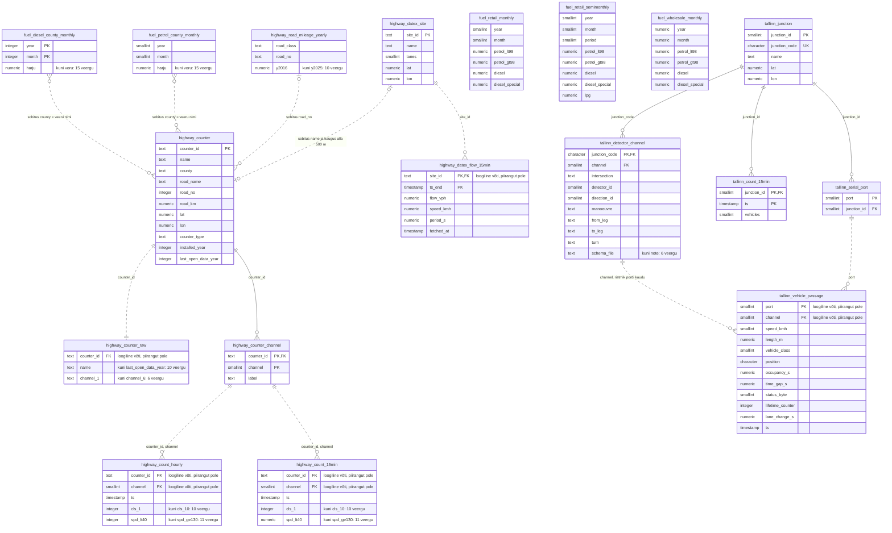

# Andmebaasi skeem (ERD)

Analüüsiskriptid loevad kõik andmed PostgreSQL-i andmebaasist (`common.py`: `sql`, `tabel`, `puhver`). Andmebaasis on 18 tabelit kolmes skeemis: `highway` (maanteed), `fuel` (kütusemüük) ja `tallinn` (Tallinna ristmikud). Ridade arv ja periood seisuga 05.11.2026.

Diagrammis on skeem ja tabel ühendatud alakriipsuga (`highway_counter` = `highway.counter`). Pidev joon on andmebaasi välisvõti; katkendjoon on loogiline seos, mida kasutab analüüsikood, või sobitus nime või numbri järgi (silt algab sõnaga „sobitus”). Vahemikuveerud (nt `cls_1` … `cls_10`) on näidatud esimese veeruna.

## Tabelid

| Tabel | Sisu | Ridu | Periood | Primaarvõti |
| - | - | - | - | - |
| `highway.counter` | maanteede püsiloendurite asukohad | 147 |  | counter_id |
| `highway.counter_raw` | loendurijaamade algne loend (koordinaadid parandamata) | 147 |  | – |
| `highway.road_mileage_yearly` | põhimaanteede aastane läbisõit, mln sõidukikm | 14 |  | – |
| `highway.counter_channel` | loenduri rajad (kanalid) ja nende nimed | 302 |  | counter_id, channel |
| `highway.datex_site` | DATEX II mõõtekohad | 233 |  | site_id |
| `highway.datex_flow_15min` | DATEX II 15 min vood ja kiirused | 16 254 | 08.09–01.10.2026 | site_id, ts_end |
| `highway.count_hourly` | püsiloendurite tunniloendused klasside ja kiirusvahemike kaupa | 15 037 858 | 01.01.2019–31.10.2026 | – |
| `highway.count_15min` | samade loendurite 15 min loendused | 22 465 472 | 01.01.2019–04.10.2026 | – |
| `fuel.petrol_county_monthly` | bensiinimüük maakonniti, kuu kaupa | 91 | 02.2019–08.2026 | – |
| `fuel.diesel_county_monthly` | diislimüük maakonniti, kuu kaupa | 91 | 02.2019–08.2026 | year, month |
| `fuel.retail_monthly` | tanklate jaemüük, kogu riik, kuu kaupa | 95 | 02.2019–08.2026 (09–12.2026 tühjad) | – |
| `fuel.retail_semimonthly` | tanklate jaemüük, kogu riik, poolkuu kaupa | 136 | 01.2021–08.2026 | – |
| `fuel.wholesale_monthly` | hulgimüük, kogu riik, kuu kaupa | 95 | 02.2019–08.2026 (09–12.2026 tühjad) | – |
| `tallinn.vehicle_passage` | iga sõiduk eraldi rida (Traffic 24h) | 19 689 418 | 30.09–23.10.2026 | – |
| `tallinn.serial_port` | kontrolleri port → ristmik | 108 |  | port |
| `tallinn.junction` | ristmikud MP01…MP50 | 50 |  | junction_id |
| `tallinn.count_15min` | ristmike 15 min loendused (seire.tallinn.ee T09) | 3 579 072 | 29.07.2024–04.10.2026 | junction_id, ts |
| `tallinn.detector_channel` | mida iga ristmiku kanal loendab (manööver) | 462 |  | junction_code, channel |

## Nimereegel

- Väiketähed ja alakriips, ainult ASCII: ükski nimi ei vaja SQL-is jutumärke.
- Skeem on andmevaldkond: `highway`, `tallinn`, `fuel`.
- Kirjeldustabel on ainsuses nimisõna (`counter`, `junction`); mõõtmistabel on mõõdik ja ajasamm (`count_hourly`, `count_15min`, `retail_semimonthly`); sündmuste tabel on nimetatud sündmuse järgi (`vehicle_passage`).
- Viitav veerg kannab viidatava võtme nime (`counter_id`, `junction_id`, `junction_code`).
- `ts` on intervalli algus, sõidukikirjetel sündmuse aeg; DATEX-i `ts_end` on 15 min akna lõpp.

## Märkused

- Välisvõtmeid on neli, kõik kirjeldustabelitel. Mõõtmistabelite seosed on kirjas analüüsikoodis; 05.11.2026 kontrollis iga seose: seoseta ridu ei ole.
- Primaarvõti puudub tabelitel `highway.count_hourly`, `highway.count_15min` ja `tallinn.vehicle_passage`. Tunnitabelis on vanu kordusridu aastatest 2019–2021 (erinevate väärtustega), millega `load_daily()` arvestab.
- Kütusemüük seotakse loendustega aja järgi (`year`, `month`). Maakonnatabelites on iga maakond eraldi veerg: `highway.counter.county` väiketähtedega, sidekriips alakriipsuks, annab veeru nime (Harju → `harju`, Ida-Viru → `ida_viru`).
- `highway.counter_raw` on algne jaamade loend; `highway.counter` on sama loend, kus neli koordinaati on 21.10.2026 DATEX-i järgi parandatud.
- Analüüsikood kasutab sisemiselt endisi veerunimesid (`id`, `kanal`, `aeg`, `"1"`…`"10"` jne): päringud ja `common.tabel()` nimetavad veerud tagasi (`common.VANAD_VEERUD`), nii et joonised ja väljundtabelid ei muutunud.
